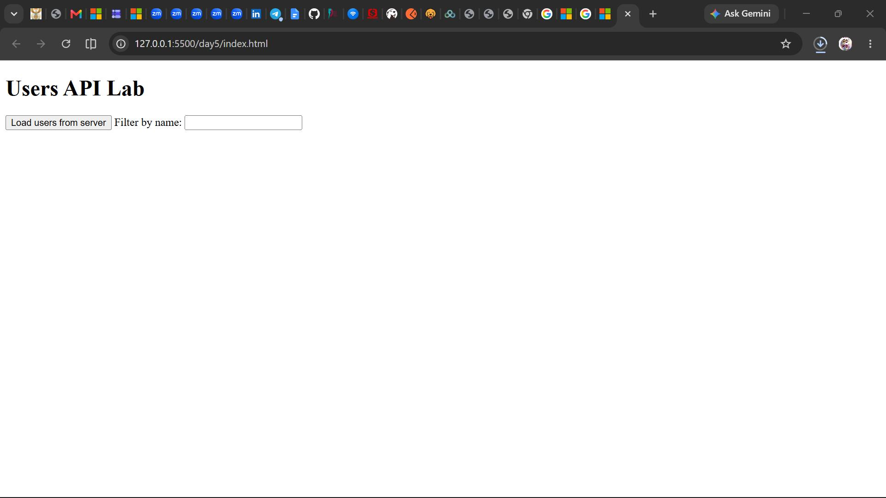
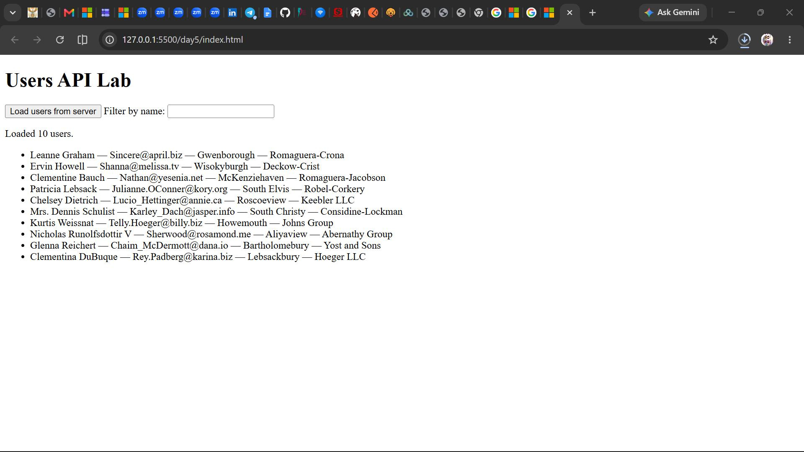
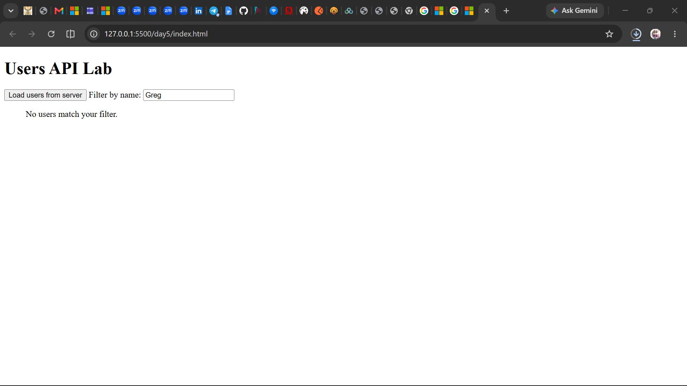

# Day 5 — Users API Lab

## 📌 Description
This exercise demonstrates fetching data from an API, handling loading and error states, and filtering results on the client side.  
The app loads users from JSONPlaceholder and displays their name, email, city, and company. A filter box allows searching by name without making a new request.

## ✨ Features
- Load users from JSONPlaceholder with a button click.
- Show loading and error messages in the status area.
- Disable the button while loading to prevent duplicate requests.
- Display each user’s name, email, city, and company.
- Filter users by name (case‑insensitive).
- Show “No users match your filter.” when nothing matches.

## 🚀 How to Run
1. Open `day5/index.html` in your browser (use Live Server or double‑click).
2. Click **Load users from server**.
3. Type in the filter box to narrow down the list.

## 📸 Screenshots

**Initial Page**  

**Loaded Users**  

**No Users Match Filter**  

## 📖 What I Learned
- How to use `fetch` with async/await and proper error handling.
- The importance of checking `response.ok` instead of assuming success.
- How to disable UI elements during async operations.
- How to filter arrays in JavaScript and re‑render results dynamically.
- How to structure REST API documentation with clear endpoints and status codes.