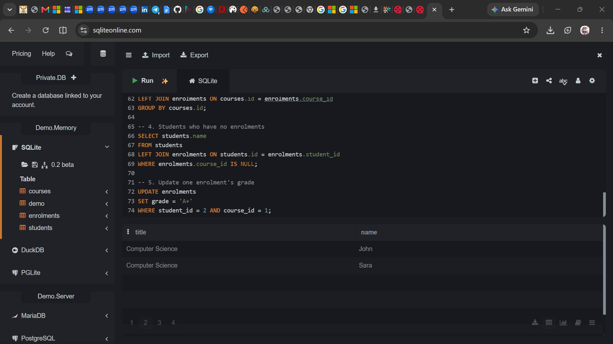
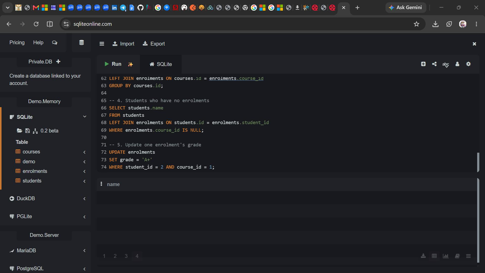

# Day 6 — School Database Lab

## 📌 Description
This lab designs a relational database for a school system with **students**, **courses**, and **enrolments**.  
It demonstrates one‑to‑many and many‑to‑many relationships, composite primary keys, foreign keys, and SQL queries for common tasks.

## ✨ Features
- CREATE TABLE statements for students, courses, and enrolments.
- Constraints: UNIQUE student email, composite PK on enrolments.
- Sample data: 3 students, 3 courses, 5 enrolments.
- Queries:
  - All courses for one student.
  - All students on one course.
  - Number of students per course.
  - Students with no enrolments.
  - Update one enrolment’s grade.

## 🚀 How to Run
1. Open [sqliteonline.com](https://sqliteonline.com).
2. Paste the contents of `day6/school.sql`.
3. Run the statements and queries.
4. Verify results match the screenshots below.

## 📸 Screenshots

**Courses for a Student**  

**Number of Students per Course**  

**All Students Table**  

**Filter by Name Query**  

## 📖 What I Learned
- How to enforce uniqueness and prevent duplicate enrolments with composite keys.
- How JOIN and GROUP BY are used to combine and aggregate data.
- Why a join table is essential for many‑to‑many relationships.
- How indexes improve query performance.
- Why SQL is the right choice for structured relational data in this system.